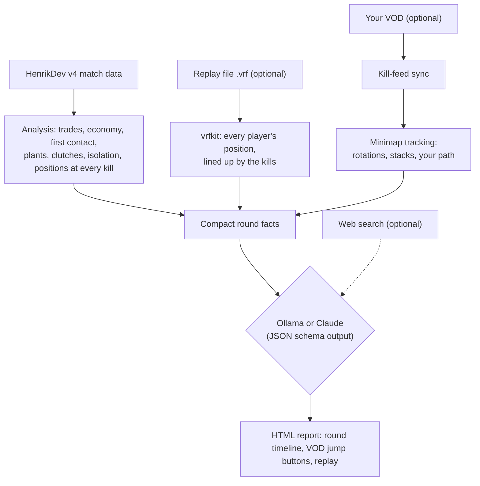

# Nexus

**Version 4.16.0** · what changed in each version: [CHANGELOG.md](CHANGELOG.md) · the running version is shown
next to the logo in the web app, in *Settings*, at the top of every report, and in `nexus --version`.

Local Valorant coach for **your team (IGL / macro)** and **you individually**,
with a web app so several players can use it.



**Contents:** [Install](#1-install) · [Start the web app](#2-start-the-web-app) ·
[Recording settings](#3-recording-settings-needed-for-the-video-part) · [Command line](#4-command-line-still-works-same-engine) ·
[How it works](#5-how-it-works) · [Known limits](#6-known-limits) · [Contributing](CONTRIBUTING.md) · [Security](SECURITY.md)

---

## 1. Install

```bash
git clone https://github.com/ManuelSqp/valcoach.git && cd valcoach
python3 -m venv .venv          # Python 3.11 or newer
source .venv/bin/activate
pip install -e ".[dev]"
pytest -q                     # ~170 tests, ~3 min, builds a synthetic match + VOD
ollama pull qwen3.8:27b       # default; alternatives below
```

**Update:** `git pull`, then `pip install -e .` and restart the app (`sudo systemctl restart nexus`,
or `docker compose up -d --build`). Your `data/` folder and `config.toml` aren't in git, so they stay as they are.

### What the server needs

- **The model is the heavy part.** The suggested models are 16–19 GB. The coaching is fast when the whole model
  fits in GPU memory (NVIDIA or Apple Silicon unified memory); if only part of it fits, Ollama runs the rest on the
  CPU and every report takes much longer. The *Server* page shows how much of the model is on the GPU. A smaller model
  or Claude (no GPU needed, see below) are the alternatives.
- **The video part** (sync, minimap, clips) runs on the CPU with OpenCV and ffmpeg; a faster CPU just means
  the VOD step finishes sooner.
- **Disk space:** VODs are several GB each. Uploaded VODs are stored in `data/`, so plan space for them or delete
  old ones.
- **ffmpeg** for clips (`sudo apt install ffmpeg` / `brew install ffmpeg`); without it, everything else still works.

### Which model

Any Ollama model works; set it in *Settings → Ollama → Model*. Some good choices:

| Model | Download | Notes |
|---|---|---|
| `qwen3.8:27b` (default) | ~18 GB | Dense, newest Qwen |
| `gemma4:26b` | ~16 GB | MoE, only ~4B active per token, so much faster per round |
| `gemma4:31b` | ~19 GB | Dense; the bigger Gemma |

Both families are reasoning models. *Settings → Reasoning* is **Off** by
default (fast; the task is turning facts into feedback, not puzzle-solving).
Try **On** if the feedback is shallow. Compare models by coaching the same
match with each and use *Run again*.

**Claude (optional).** With an Anthropic API key under *Settings → Claude*,
Claude Haiku, Sonnet and Opus show up in the model picker next to every button
that runs the model (coaching, tips, game plans, weekly focus, reviews, quiz,
what to watch). The local model stays the default; each user's last pick is
remembered. Admins can use Claude; other users only after *Users → Can use
Claude*. A monthly budget stops Claude when it's spent, and with fallback on the
local model finishes the job if the API can't be used. Nightly reviews and the
weekly focus use *Model for automatic jobs*. Costs per day and month are on the
server overview. The key can also come from `ANTHROPIC_API_KEY`.

**Web search (optional).** Under *Settings → Web search* the coach can look things up instead of guessing (patch
changes, abilities, pros, KovaaK's playlists and share codes) in *Ask the coach*, in the questions about a round of a
report and on the Aim page; answers list the pages they used. Pick a main search and a backup, which takes over
when the main one fails or finds nothing:
- **DuckDuckGo**: free, nothing to set up. DuckDuckGo has no official search API, so Nexus reads its plain HTML
  results page, and DuckDuckGo often refuses searches that don't come from a browser (sometimes the very first one).
  Fine as a backup; for the main search SearXNG is the reliable choice.
- **SearXNG**, your own search server (free, nothing leaves your network except the searches). It has to answer
  JSON: in SearXNG's `settings.yml` set `search: formats: [html, json]` and restart it. Enter its URL (or set
  `SEARXNG_URL`, which also makes it the backup).
- **Claude's web search** with the Anthropic key: US$ 10 per 1,000 searches plus tokens, counted in the Claude budget.

*Test* checks the main search and the backup one by one. Set the main search to *Off* to turn web search off.

The model decides per question whether to search (at most three searches) and reads the top pages. Pages are only
fetched from public addresses, never from the server itself or your LAN.

## 2. Start the web app

```bash
source .venv/bin/activate
nexus web                  # http://<ip>:10070
```

Options: `--port 10070`, `--host 127.0.0.1` (this PC only), `--data data`
(folder for the database, cache, uploads and reports).

On the first start you create the **admin account**. If you used an earlier
version, your existing players and reports move into that account
automatically.

Then in the browser:

1. **Settings** (admin): paste the HenrikDev API key (HenrikDev Discord → `#get-a-key`
   → *VALORANT (Basic Key)*), check that Ollama shows as reachable, choose the model.
2. **Users** (admin): add an account for each teammate, optionally with a
   recordings folder on the server. Or turn on *Allow sign-up* in Settings so
   they can create their own accounts.
3. **+ Player**: Riot name, tag, region (EU), default coaching mode and,
   optionally, the team playbook (there's an *Insert example* button).
4. Open the player → **Recent matches** → **Coach** on a match.
5. Choose what to coach, pick the recording (or *No VOD*, or upload one) →
   **Start coaching**. The job page shows progress; **Open report** when done.
6. **Notes** next to each match: write what went wrong/right per round. This is the
   biggest quality lever: notes for the match go to the coach, and your notes from
   other matches teach it the kind of feedback you want.

### Finding your way

One menu on the left (☰ on a phone). At the top you pick the **team** and the **player** it works on; opening a team
or player page picks it for you. Below: *Match day* (This week, Availability, Match-day brief, Opponents),
*Strategy* (Comps, Drafts, Game plans, Strat book, Lineups), *Performance* (Matches & reports, Stats & maps,
Agents & roles, Rounds & economy, Teammates, Rank & progress), *Practice* (Training, Habits, Aim, Ask the coach, Practice plan, Review evening, Weekly focus, Quiz, Pros & videos) and *Roster & setup* (Roles, Team notes,
Player & playbook, Team settings). Ctrl+K searches everything. *Home* shows what's up today. The look (10 styles,
light or dark, menu on the left or at the top, centred or full width) is under Account.

**Deutsch / English:** every user picks the interface language under Account › Look & feel (the login page
follows the browser, or the switch above the form). Menus, pages, messages, notifications and, per team, the
Discord posts are translated; the coach's own texts stay in each player's coaching language. Translations live
in `nexus/i18n/de.json` (`#` = any number, `{name}` = any text); a missing line simply stays English.

**On your phone or a second screen:** Account › *Install as an app* puts Nexus on your home screen (no app
store) and turns on notifications (report ready, match day). *Match day › Match screen* shows the comp, plans,
strats, lineups and the opponent for the match you're playing, with an Attack / Defense switch. A finished report
can be shared as a read-only link (on its page: *Make a share link*).

**Habits and practice:** *Practice › Habits* tracks six habits that cost rounds game by game (gone, getting better,
still there, getting worse) and checks whether the coach's tips worked. *Practice › Practice plan* makes the team's
week of practice from those habits, the week's map, its strats and lineups, with reminders on Discord and your phone.
*Practice › Review evening* goes through one match round by round together: the host moves, everyone follows on his
own screen and marks his own rounds (my fault, good, talk about it); the summary goes into the practice plan.
*Practice › Aim* keeps aim routines (Aimlabs share links, KovaaK's codes, steps for the Range), picks the ones that fit
your matches and sets your warm-up, which shows on the match screen, in the practice plan and as a push before the match.
For KovaaK's the coach writes the playlists itself: download one (dated DD-MM-YYYY in its name), save it in
`FPSAimTrainer/Saved/SaveGames/Playlists` and it shows up under *Local Playlists*. Import your KovaaK's scores (the `.csv` files in `FPSAimTrainer/stats`, or the
folder as a zip) and it moves you to harder scenarios once you're steady at your best. More scenarios: import any
playlist file, add one by hand, or let them come in with your scores. *Playlists from the community* suggests public
KovaaK's playlists by share code (paste it under *Sandbox › Online Playlists › Enter Share Code*), and with web search
the coach finds more online.

**Aim trainer:** *Practice › Aim trainer* is an aim trainer in the browser (and in the Nexus app) that plays like
Valorant: your Valorant sensitivity (0.07° per mouse count × sens), Valorant's field of view and raw mouse input
(Chrome, Edge, the Nexus app; other browsers get a warning). Eleven scenarios in three groups: flicks (grid, head-line,
micro, close, far), duels (peek reaction, *Hold the angle* with an enemy model and headshots only) and tracking (strafe,
close, far, reactive), a short daily warm-up and a training picked from what your matches show. Your Valorant crosshair
(paste its code) is set inside the trainer. Scores are
kept per player, finishing a warm-up or training ticks it off on the Aim page, and the coach knows the scores.
The *Sens finder* plays a short mixed test at different sensitivities, blind and in random order (a wide spread around
yours, then close around the best) in 5, 15 or 30 minutes (the longer ones test close and far flicks and close, far
and reactive tracking separately, show which sens each likes, and correct for tiring), measures how you hit (overshooting, stopping short, time, tracking), fits a
curve and recommends a sens with a range that works about as well. Tests of the last 90 days are combined; a big
change is split into weekly steps.
*Practice › Aim insights* shows what the trainer's rounds say about how you aim (last 30 days): flicks per direction
(left against right, up against down, small against big, flying past or stopping short), where missed shots land,
tracking per direction (on target, behind or ahead, catching up after a direction change), reaction to peeks from each
side and where the crosshair waited. What stands out comes with tips for your hand and grip (set on the page) and
scenarios to play, next to charts (skill profile, a flick wheel, a miss map) and a *Focus training* that also appears
on the trainer page. Only rounds played since 4.8 are measured this way.
*Practice › Mouse & monitor* measures the real DPI of your mouse (move it a known distance along a ruler), its polling
rate, your screen's refresh rate and worn buttons that double-click, and works out eDPI and cm per 360°. A browser
can't fully measure 2000–8000 Hz mice, and the page says so.

**Ask the coach:** *Practice › Ask the coach* is a chat with the coach about one player. It knows the player's stats,
habits, aim and KovaaK's scores and remembers the conversation (per user and player).

**Nexus for Windows:** [desktop/](desktop/README.md) is an app that shows Nexus in its own window and adds
*This PC* to the menu. It puts the coach's KovaaK's playlists into KovaaK's, sends new KovaaK's scores, and cuts
the matches out of Medal session recordings (by the start time in Medal's file name and Riot's match start) and
uploads them, so the recording is picked already on the match's coach page. You log in in the window like on the
website; the app then gets its own key for that PC (*Account › Nexus app for Windows* lists and removes them).
Install it with `nexus-setup.exe` from the releases; it has the same version as Nexus and updates itself.
Uploaded clips no report used are deleted after 14 days (`companion_keep_days`).

### What's in a report

- **Rounds**: the list on the left has one button per round showing what happened at a glance
  (buy, first kill/death, plant, when you died, clutch, lead thrown, comeback, ★ = round with a lesson).
  Click a round to expand the coaching (key moment, team and personal feedback, VOD jumps); the panel
  on the right switches to that round's replay. It stays in view while you scroll. The **Video** tab
  shows the VOD; 🎬 buttons jump there.
- **Round replay**: plays the whole round on the minimap, with play/pause,
  0.5–4× speed and a timeline with a tick for every kill and the plant.
  - Every player is shown as their agent portrait in a ring of the team colour, greyed with ✕ once dead.
  - Trails show the last few seconds of movement, and view cones appear around each kill snapshot.
  - **Click a player** (on the map or in the list) to draw their whole route for the round with
    timestamps, e.g. to see how long a flank took.
  - The kill feed on the right jumps to each event. Zoom with the + / − buttons or Ctrl + mouse wheel (the plain wheel scrolls the page),
    drag to pan, and use ⛶ for fullscreen. Keys: space = play/pause, ← → = 1 s.
  - 🎬 jumps the VOD to the same moment (if the report has one).
  - **What's measured vs. estimated:** the API gives everyone's position only at kills, plants and
    defuses. Everyone starts in their spawn. In between, movement is estimated as the shortest
    walkable route at running speed: from spawn they move first and then wait; later they hold
    their last known spot and move just in time to reach the next one. Solid icons are known
    positions; faded icons with a dashed ring are estimates.
  - **With a VOD** your own path and your **teammates' paths** are measured from your minimap
    (they're on it all round, also while you spectate). Who is who is taken from the exact API
    positions at every kill and carried between kills; where two icons cross or merge and the
    identity is unclear, that stretch is estimated instead. Teammates measured like this show
    "tracked on video" in the player list, and the log says per round how much was covered.
  - **Enemies** are only on your minimap while someone sees them; those sightings are drawn as red
    rings (no name: the minimap doesn't tell which enemy it is).
  - The coach's **better spot** (dashed circle + arrow) shows up around its time.
- **Duels**: did you die while looking at your killer (lost aim duel), or was they
  at your side / behind you (positioning)? Damage you did to your killer, kills and
  deaths by range, headshot / leg-shot share per main weapon.
- View directions come from the API. Nexus checks them per match (killers must
  face their victims); if the data doesn't fit, duel analysis falls back to
  positions and damage and the log says so.

### Stats, agents and team comps

**Performance › Stats & maps.** *Import match history* loads your Competitive, Premier and Unrated games from HenrikDev
in the background: the last ~60 per queue with full round data (10 per request) and up to 300 older ones per
queue from the stored archive (summaries only, 20 per request). *Update* later only fetches what's new.

- **Maps and agents**: games, win rate, ACS, K/D per map and per agent, filterable by queue (All ranked,
  Competitive, Premier, Unrated, or Everything).
- **Agents & roles** (its own page): every agent you played with all numbers (sortable, per map on click), the
  agent class you pick most, the team role your habits fit (0–100 per role, from first fights, trades, fights far
  from the team, holding a site, assists, Operator), whether the two match, and three agents to try. *Details* on
  an agent: progress over time, utility per ability and you against everyone else on that agent in your matches;
  plus an agent × map grid.
- **Rounds & economy**: pistol / eco / force / full-buy win rates, uneven buys, bonus rounds, post-plants and retakes.
- **Teammates**: who you win with (games, win rate, your ACS with them, premade or random).
- **One map in detail**: your agents there, team win rate per side, where you take opening duels and how often
  you win them, where you die and how often that gets traded, and what's played at your level (all 10 players
  of your matches). Short findings are listed only when there's enough data behind them.
- **Coach tips**: *Write tips* has your model turn those numbers into an agent pool verdict (main / backup /
  drop) and tips per side, each with its evidence. Runs in the background, uses the same Ollama settings.
- **Pick helper** (solo queue): choose the map and what your teammates locked; it ranks your agents by your
  numbers on that map and what the team still needs (Controller first). If you don't play the missing role,
  it says so and names what's played at your level.

**From your Premier team.** On *Teams*, enter your Premier team as `Name#TAG` and its region. The app loads the
roster from HenrikDev, adds every player (players you already have are reused), makes the 5 who played the most
recent Premier matches the starters and the rest subs, and imports everyone's stats in the background.
*Sync Premier roster* on the team page picks up roster changes later and keeps the roles you set.
Every team also syncs by itself each night at 02:00 server time (Premier roster, then everyone's stats); change
the hour or turn it off under *Members, maps & Discord* → *Automatic sync*.

**Roles tab.** Every player gets a 0–100 fit for IGL, Entry, Second entry, Lurker, Anchor, Support, Operator and
Flex, from their games with round data (first into fights, trades, how far from the team they fight on attack,
which site they hold on defense and how long they survive there, Operator rounds, how many agent roles they play).
IGL can't be seen in data (no comms): its number is a guess from traits that make calling easier. Tick the roles a
player actually has: the **suggested lineup** keeps them and fills the rest with the best fits, a role that doesn't
show in someone's data gets a gentle "worth talking about", and each player gets an **agent to learn** (an agent
role that suits their team role and that the team is thin on, picked from what's played at your level).

**Whole-team match review.** *Review the whole team* on the coach page (on by default) adds a **Your team** section to
the report: every player of your team gets what went well, what to fix (with round links) and **how the team can
help them**, judged against their roles. The *Together* tab shows trades, deaths not traded, deaths alone and
deaths while outnumbered for everyone, and who traded whom. CLI: `nexus coach <match> --team`.

**Sharing a team.** Teammates get their own login (admin: *Users*, or turn on sign-up) with their in-game name.
Under *Members, maps & Discord → Teammates with access* you add them; they then see the team and their teammates'
stats (view only) and can write notes. Tabs on a team: **Comps**, **Game plans** (3 detailed plays per map with a
step per player), **Weekly focus** (one focus per player), **Player overview**, **Roles**, **Notes** (yours + tips
from your matches together) and, for the owner, **Members, maps & Discord**.

**Player overview** (*Roster & setup*, 4.11) shows who plays what, calculated from the stored games: per player the
role (assigned on *Roles*, else the suggestion, marked "?") with IGL / Operator, the most played agents with games and
win rate, the split over the agent roles, the playstyle and the best maps. Playstyle (4.12): up to three labels
such as *Aggressive*, *Patient*, *Clutch player*, *Trader*, *Lone wolf*, *Survivor*, *Fragger*, *Playmaker*,
*Brawler*, *Long-range duelist* or *Operator player*, each with the numbers it rests on (hover or tap it), plus four bars
(opening duels, kills, assists, survival compared with your lobbies) and the closest pro. **Thrives in / struggles
in** compares a player's results in opening duels, clutches, retakes, post-plants, close / mid / long-range duels,
attack and defense, fights away from and next to the team, and trades with typical ranked values; small samples are
pulled towards typical and need a minimum count before they show (`stats/archetypes.py`). Few trades are never
listed as a weakness: they mostly come with the role. On top, which agent roles each starter plays regularly,
roles nobody covers and mains that collide. Two views: **Top 5 agents** (a card per player) and **All agents** (every
agent and map as a table, players side by side, plus roles and playstyle in one table).

**Comp sheet** (*Strategy › Comp sheet*, 4.13) is the team's agent pool and ideal comps on one page. **Agent pool:**
a column per player with his agents from best to worst (green to red), starting from the stats (most played, then
win rate). Each player edits his own column (linked by the in-game name; the team owner can edit all): move agents
up or down, add agents he wants to play, mark agents he won't play. Agents played later are added at the end;
*Back to the stats* drops the changes. **Ideal composition:** per map the comp the web sources name most (the team
owner clicks *Search the web*, needs web search under *Settings*), or 5 agents set by hand. Under every agent: who on
the team has it in his pool and how high (`stats/compsheet.py`).

**Follow our agent pools** (4.14, a switch next to *Make comps with* on the comps page, on the comp sheet and in the
team settings; off by default): the comps then use these pools in every mode, also for drafts and the Discord
prep. Agents a player won't play are left out, agents he ranked high get a bonus (in *Most comfortable* his own
order replaces the games-played count), and agents he added by hand can be picked even without games. The reason
shows with every pick, e.g. "#1 in Sam's agent pool". The team owner switches it.

**Look & feel.** Every user picks a style (ten, from Classic to Retro arcade) and switches the animations on or
off under *Account › Look & feel*. **Ctrl+K** (or `/`) opens a quick search for players, team tabs, maps, drafts
and strat boards. The strat book has a **Lineups** library with clip links per map, agent and ability.

**Progress and Training** (player tabs). *Progress* shows your numbers week by week with trends, whether each
weekly focus moved its number, and clutches / retakes / post-plants. *Training* has your aim fundamentals (headshots,
fights by range), what to work on, a 20-minute warm-up with a streak, teammates to learn from, and up to five agents
to learn with a learning path that ticks itself from your games.

**Premier.** On a team linked to Premier, *Match day › This week* has this week's map, *Match-day brief* (also posted
to Discord before your matches: set days, time and minutes before), reviews of your Premier matches (every night,
posted to #match-prep), and *Opponents*: every team in your division scouted in advance from its recent
Premier matches, with a page per team (how to play them, players, comps per map) and a map veto for playoffs.
The first division scout takes a few minutes (HenrikDev rate limit); after that it's quick and runs nightly.

**Drafts.** On a team, *Drafts* → pick a map → *+ New draft* (your starters in the slots) or *Use* one of the
suggested comps. Drag agents from the list onto a player (the small box under it is a backup pick), drag between
slots to swap, drag out to remove; or click a slot and then an agent. Each slot shows that player's games and win
rate on the agent (on this map and overall) and their best agents here. *Check* shows the role mix and warnings
(same agent twice, no controller, a player who has never played their agent). Status *Idea / Trying / Our comp*,
notes for what you discussed, *Duplicate*, *Post to Discord*. Everyone in the team can edit; it saves by itself.

**Strat book.** On a team, *Strat book* → *New strat* (or *Draw it* on a game plan). Drag agents and their
abilities onto the minimap (or click an ability to drop it at that agent), add arrows, walls and text, split the
play into steps, and write the calls in the notes. Abilities are drawn at their in-game size and in the agent's
colour: smokes as clouds (Omen purple, Brimstone tan, Viper green, Astra violet, Clove pink, Harbor blue...),
mollies and zones as circles, and lines like Fault Line, Rolling Thunder, Armageddon or Toxic Screen start where
they're cast; drag the yellow handle to aim and stretch them (within the ability's real range). Sizes are in
`web/abilityshapes.py`; the ones marked approx are estimates and every size can be changed on the board. Everyone in the team can edit; it saves by itself. *PNG* downloads the current step, *Post to Discord* sends
it to #match-prep. Shortcuts: `V` select, `A` arrow, `P` path, `W` wall, `T` text, `Del`, `Ctrl+D` copy,
`Ctrl+Z` undo, `←`/`→` steps, `Ctrl`+wheel zoom.

**Discord.** Paste a webhook URL per channel (channel settings → Integrations → Webhooks → New Webhook):
#match-prep gets the top 3 comps per map and the game plans (*Post to Discord* on the Game plans tab),
#weekly-focus gets the weekly focus, automatically on the day and hour you choose (server time).

**Player → Pro & videos** compares your playstyle with pros and gives you videos to watch:

- **Your playstyle** in four numbers: how often you take the first duel, kills, assists and survival, each as a
  percentile among the players in your own matches (from the round data of all 10 players per match).
- **Pros with a similar style**: half style, a quarter role, a quarter shared agents, with what you have in common
  and the biggest difference. The pro list is a starting point written from public play styles as of mid-2026;
  admins edit it under *Settings → Pro players* (rosters change).
- **Pick a pro**: click a card (the closest is selected at first). The summary and *What to watch* follow it.
- **What to watch**: up to six YouTube searches built around the selected pro and your numbers: that pro on your
  agent and map, how they do what they're better at than you, their other agent, your weakest map, and your weak
  spots (e.g. the area where you lose opening duels). *Write what to watch for* has your model add, per search,
  what to look for, plus what to copy from that pro and habits to practice; *All 3 pros* writes it for each.
- **Inline videos (optional)**: add a YouTube Data API key under *Settings → Pro players & videos* (Google Cloud
  console → enable *YouTube Data API v3* → Credentials → API key). The page then shows the videos themselves
  (recent uploads, cached for a day; the free quota is about 100 searches a day). Without a key it shows search links.

**Teams** (*All teams* in the team picker at the top of the menu) is for Premier: add your teammates as players,
make a team, and under **Members & maps** choose 5 starters, any substitutes and the map pool. Then press
*Update everyone's stats*. **Strategy › Comps** shows all maps at a glance (one row per player, one column per
map); click a map for the details:

- a comp: one agent per starter, from their win rate and ACS with that agent on that map (pulled towards
  their overall numbers when there are few games), how much they play it, and how often it's played at your
  level. Every comp needs a Controller, an Initiator and a Sentinel. Dashed cards have little data behind them.
- **If someone is missing**: which sub comes in on which agent, and who should switch.
- **Map meta** (optional, per team): `prefer` / `avoid` agents and a fixed role mix per map, e.g.
  `Lotus: {roles: 1D 1I 2C 1S}`. A role mix you set is followed whenever the players' pools allow it.
- **Comp suggestions** (on the comps page: *Make comps with* … *Make comps*, or team settings; four modes since 4.10). **Map rules + your stats** (default) adds what the numbers can't know:
  per map the role mixes that work there and the agents the map needs or rewards (a Viper wall on Breeze and
  Icebox, recon on Ascent, …), and for every comp a controller, at most two duelists, someone to flash corners and
  someone for information. Each rule that changed a comp is listed under it (*Map rules: no Viper: …*), and the
  picks say why (*needed on Breeze: …*). The rules only tip the balance: a player who is much better on another
  agent still gets it. **Your stats only** makes comps exactly as before 4.9. The rules are a YAML file
  (`nexus/stats/comp_rules.yaml`) that admins edit under *Settings › Map rules for team comps* when the meta moves;
  a team's own map meta still wins over them.
  **Most comfortable** puts every player on the agents he plays most: games on that map count most, then games
  overall; win rates and ACS don't count (the basic roles still do). **From the web** uses comps that web sources
  name for each map: on the comps page, *Search comps for <map>* (or *All maps*) searches with the search set up
  under *Settings › Web search*, reads the best pages, and the model lists the full 5-agent comps they name, with
  the sources (comps of 5 real, different agents only). Each one is handed to your players, every agent to the
  player who does best on it, and the comp that fits your players best comes first; an agent a player has never
  played is marked *new agent*. A map nobody has searched yet uses the map rules + your stats. The found comps stay
  until they are searched again.

The current patch meta isn't available from any API, so "played at your level" comes from your own matches,
and the meta box is where you put what you know. Suggestions are only as good as the sample: check the game
counts shown next to each pick.

### How reliable the coaching is (4.15)

Nexus doesn't count every number the same any more:

- **Recent games and the current patch count more.** A game counts half as much every 45 days, a game from an
  older patch 60 %, and a game against a stronger lobby a bit more (a weaker one a bit less). The comp maker and
  the coach use these weighted numbers; *Stats & maps › How much the numbers tell* shows them next to the plain
  ones. Games keep their real count ("7 games on Jett").
- **Buy state and lobby strength.** Rounds are split into full buys on both sides, rounds against a saving enemy
  (anti-eco) and your own eco / force rounds, each with round win rate and K/D. If a K/D mostly comes from anti-ecos,
  it says so. Games are also split into stronger / similar / weaker lobbies. The *Thrives in / Struggles in* lists
  include the buy states.
- **How sure.** Every playstyle label and every "thrives / struggles" line says *solid* or *early sign* (few
  rounds so far, marked *). The coach gets the same marks and is told to quote the number behind each point and to
  call an early sign an early sign.
- **Replay files** (when uploaded): *Habits › From your replay files* shows *untradeable deaths* (no teammate within
  15 m when you died or in the next 3 s), how often and how fast you get to the spike on retakes, and where you
  stand 20 s into the round per map and side, with the win rate of each spot. Worked out once per match (stored
  as `<match id>.metrics.json` next to the replay). Since 4.16 also **utility timing** from the ability casts
  in the replay: how often you used an ability before your first fight of a round, how often you died without
  using one, and when your first ability comes (median, attack and defense); the coaching run sees each round's
  casts too. Replays stored before 4.16 are read again once for this (needs the kept `.vrf` and vrfkit on the
  server). *Dying with utility unused* on the habits list still comes from the match data (works without replays).
- **Goals** (*Habits › Goals*): one number, a target and the next 5–20 games. The weekly focus sets one for each
  player from its "number to watch", *Make it a goal* on a habit sets one, or you set one by hand. Nexus checks it
  after every game: *reached* as soon as the number over the games since meets the target, *missed* when the games
  are over. The coach sees open goals and the results of the last 60 days, so it builds on what worked and changes
  approach where a goal was missed.
- **Check-in** (*Match day › Check-in*): after a match the team played together (3+ players), each player answers
  in about 20 seconds: who made most of the calls, comms 1–5, mood 1–5, one optional line. The team owner can
  answer for players without an account. From 3 votes for the same player, the IGL suggestion uses the check-ins
  instead of a guess from the stats. Premier reviews, the weekly focus and *Ask the coach* get the answers.
  When Nexus posts a Premier review to Discord, the post starts with a link to that match's check-in (4.16; the
  link uses the address Nexus was last opened at, so open it once in a browser after an update).

The new numbers come from the match data Nexus already has: the next stats update (or the nightly sync) rebuilds
the rows from the cached matches, without extra API requests.

### Older matches

The player page shows 10 matches at a time; **Older →** pages back through the
full match history (each new match costs one HenrikDev request, then it's cached).
**Older history** goes further back using HenrikDev's stored archive (one request
per 20 matches, may have gaps). Very old matches may no longer have round data,
so coaching them can fail.

### Accounts and workspaces

- Every user has a **private workspace**: their players, playbooks, notes, reports
  and uploaded VODs. Other users, admins included, can't see or open them (they get 404).
- **Admins** additionally manage users (create, reset password, disable, delete
  with their whole workspace) and the server settings (API key, Ollama, video
  analysis). There must always be at least one active admin.
- Each user's **recordings folder** is set by an admin, because it's a path on
  the server. Users without one upload their VODs.
- Drag the **⋮⋮** handle on a player card to set the order of your players (Home and the player picker in the menu).
  It's saved per account. On a phone drag the handle; with the keyboard, focus it and use the arrow keys.
- All coaching jobs share **one queue** (*Settings → Coaching jobs at the same
  time*, 1 is right for one Mac). Each user can have at most 3 reports queued or
  running (*Max reports per user at once*), and an uploaded VOD may be at most
  20 GB (*Max VOD upload size*); both are admin settings.
- Only round-based modes can be coached (Competitive, Premier, Unrated, Swiftplay,
  Custom). Deathmatch, Team Deathmatch and Gauntlet show as *not coachable*.
- Passwords have at least 8 characters. Changing a password logs out the other
  devices. 5 wrong logins lock that username from that address for 10 minutes.
- Forms are only accepted from the app's own pages (checked via the browser's
  `Origin` header). Behind a reverse proxy, keep the original `Host` header or
  set `X-Forwarded-Host`.
- Forgotten admin password: run
  `python -c "from nexus.web.store import Store; s=Store('data'); s.set_password(s.user_by_name('user').id, 'new-password')"`
  in the project folder.

Only open the app on your LAN or behind your reverse proxy (with HTTPS). It
holds your API key(s) and serves the uploaded VODs.

### Where do the recordings come from?

The VOD is recorded on the gaming PC, but the app runs wherever. Either:

- **Upload** in the browser on PC (coach page → *Upload a file*). It
  shows a progress bar; a 3–5 GB VOD takes about a minute over gigabit LAN. The file
  goes up in 16 MB pieces (no request may be bigger than 17 MB), so a proxy in front of
  the app must allow at least that. Or:
- **Share the recordings folder** (SMB) from the PC or a NAS, mount it on the Server,
  and set it as the user's recordings folder under *Users*. The coach page then lists the
  files and pre-selects the one saved right after the match.

Record as **MP4 with H.264**, because browsers can't play every MKV.

### Replay files

Since patch 11.06 VALORANT can download a replay of a **Competitive or Premier** match (*Career › Match history* ›
the match › download the replay). It is saved as a `.vrf` file in `%LOCALAPPDATA%\VALORANT\Saved\Demos` and holds
the server's own data: **every player's position all round long**, plus the round starts and every death. Nexus
reads it with [vrfkit](https://github.com/yakisoba0728/vrfkit) (Apache-2.0), keeps a compact copy (4 positions per
second per player) and lines it up with the HenrikDev match data by the kills. The round coaching then gets the
real positions of both teams per 10 s (setups, stacks, rotations, timings), and the report's replay draws all ten
players' paths instead of estimating them between kills. No recording is needed for that; a VOD is still used for
the jump buttons.

- **Getting the file to Nexus**: upload it on the match's coach page (*Replay file* card), or let the Nexus app
  for Windows send new replay files by itself (*This PC › Replay files*). One file serves every player of that
  match: it is stored per match, in `data/replays/<match id>.vrf` and `.json.gz`.
- **The switch**: *Settings › Replay files › Positions*. **Replay file when there is one** (default) uses it and
  falls back to the VOD minimap when a match has none or the file doesn't fit the match data. **VOD minimap only**
  ignores replay files completely, so reports are made exactly as before 4.9. The report header says which one was
  used (*positions from the replay file* / *from the VOD minimap*).
- **vrfkit on the server**: the Docker image builds it (pinned commit, `VRFKIT_REF` in the `Dockerfile`). Without
  Docker, install it once with Rust (1.86 or newer). Rust needs a C compiler and linker (`build-essential`):

  ```bash
  sudo apt install -y build-essential pkg-config                     # Debian/Ubuntu: C compiler and linker
  curl --proto '=https' --tlsv1.2 -sSf https://sh.rustup.rs | sh     # if you don't have Rust yet
  source ~/.cargo/env
  cargo install --git https://github.com/yakisoba0728/vrfkit --rev b9ba3f70735c7219fef41ba61a80626a4bb88757 --locked vrfkit
  ```

  That puts it in `~/.cargo/bin/vrfkit`, where Nexus finds it by itself (or set the path in *Settings › Replay
  files*, or `NEXUS_VRFKIT`). *Test* there checks it. After a VALORANT patch, replays of the new build may need a
  newer vrfkit: run the same command with a newer commit (and `--force`).

### Run it permanently

**Option A: systemd** (simplest, uses your existing `.venv`)

```bash
sudo cp deploy/nexus.service /etc/systemd/system/
sudo nano /etc/systemd/system/nexus.service    # check User= and paths
sudo systemctl daemon-reload
sudo systemctl enable --now nexus
journalctl -u nexus -f                         # logs
```

After an update: `git pull`, `pip install -e .` in the venv, then `sudo systemctl restart nexus`.
The service may only write to `data/`; if a recordings folder lives somewhere
else, it still works (read-only is enough). Backups to another folder (Settings › Backups) need that folder
added to the service as `ReadWritePaths=/path/to/backups`; it must be inside `/mnt`, `/media`, `/srv`, `/home`,
`/backup(s)` or `/var/backups`, or listed in `Environment=NEXUS_BACKUP_ROOTS=/your/folder` (`:`-separated).

**Coming from valcoach (4.4 or older)?** Nexus was called valcoach before 4.5. Once, after `git pull`:

```bash
source .venv/bin/activate
pip uninstall -y valcoach && pip install -e .     # the command is now `nexus`
sudo systemctl disable --now valcoach
sudo cp deploy/nexus.service /etc/systemd/system/  # take over User=, paths and ReadWritePaths= from valcoach.service
sudo systemctl daemon-reload && sudo systemctl enable --now nexus
```

`data/valcoach.db` becomes `data/nexus.db` by itself at the first start, old backups still count, and
`VALCOACH_BACKUP_ROOTS` / `VALCOACH_MODEL` keep working (the new names are `NEXUS_…`). Logins stay valid.

**Option B: Docker Compose**

```bash
UID=$(id -u) GID=$(id -g) docker compose up -d --build
docker compose logs -f
```

- Uses host networking, so Ollama on the same host is reached at `127.0.0.1:11434`
  as before and the app stays on port 10070.
- `./data` is mounted at `/data`. Existing reports and uploads keep working:
  Nexus finds them in the new location automatically.
- Recordings folders: mount them at the **same path** as on the host
  (see the commented line in `docker-compose.yml`).
- Update: `git pull`, then the same `up -d --build`.

Use one or the other, not both (both want port 10070).

## 3. Recording settings (needed for the video part)

| Setting | Value |
|---|---|
| Recorder | OBS / Outplayed / Medal, **MP4 + H.264**, ≥1080p, ≥30 fps, full match in one file |
| Ultrawide monitor | fine: the black bars left/right of the 16:9 game are detected and left out |
| Minimap → Rotate | **Fixed** (orientation *Always the same* or *Based on side*, both work) |
| Minimap → Keep player centered | **Off** |
| Minimap size / zoom | anything, but **keep it the same** across recordings |
| Colour-blind mode / enemy highlight | default (otherwise adjust `COLOR_RANGES` in `nexus/video/minimap.py`) |
| HUD | default kill-feed position (top right) |

The first time, check the minimap/kill-feed areas with the CLI (below). If
sync fails for a match, *Advanced options* on the coach page take a manual
anchor (the VOD time of one kill).

## 4. Command line (still works, same engine)

`config.toml` (copy from `config.example.toml`) is only used by the CLI, and
on the first start of the web app to pre-fill Settings and create your profile.

```bash
nexus history                                   # last 10 matches
nexus coach latest --vod match.mp4              # full run, writes output/*.html
nexus coach <match_id> --no-llm                 # facts only
nexus calibrate-minimap <match_id> match.mp4    # debug images in output/calibration/
nexus notes-template <match_id>
```

`calibrate-minimap` draws the minimap area (orange), the kill-feed area
(magenta), the detected icons (circles) and the API positions (crosses). The
crosses must sit on the icons; if the boxes are off, change the areas in
Settings (web) or `[video]` (CLI).

## 5. How it works

| Module | Does |
|---|---|
| `henrik.py` | v4 client, `Authorization` header, 429 backoff, completed matches cached forever |
| `parse.py` | v4 JSON → models; attacking side per round (Red-attacks-first rule, verified against plants, OT alternates) |
| `maps.py` | valorant-api.com map transforms + callouts; world ↔ minimap UV; nearest callout |
| `analysis/` | team (economy, first contact, setups, player-count progression, trades, plants/retakes), player (kills, death context, KAST, clutches, utility, path) and view/duels (self-calibrating view directions, facing/side/behind, ranges) |
| `video/sync.py` | kill-feed onset detection → offset histogram vote → per-round refinement |
| `video/minimap.py` | HSV icon detection, ICP calibration against API positions, round tracking, rotations |
| `video/allies.py` | teammate identities from kill snapshots, forward/backward tracking, enemy sightings |
| `coach/` | YAML round facts → Ollama with JSON schema → match review from round digests |
| `pipeline.py` | the full run, shared by CLI and web |
| `web/` | Flask app: SQLite store (settings, users, profiles, jobs), accounts, job queue, templates |
| `coach/replay.py` | round replay data (positions, view angles, path) for the report |
| `report.py` | single-file HTML report incl. the SVG round replay |
| `stats/teamdata.py`, `stats/gameplans.py`, `stats/weekly.py`, `discord.py` | matches played together, teammate tips, map facts, game plans, weekly focus, Discord webhooks |
| `web/strats.py`, `web/static/strat.js` | strat book: storage, assets (map image, ability icons), the drag-and-drop editor |
| `web/ui.py`, `web/static/ui.js`, `web/static/styles/*.css` | styles per user, animation switches, Ctrl+K search |
| `web/lineups.py` | lineups library in the strat book |
| `stats/progress.py`, `stats/training.py`, `web/player_views.py` | Progress and Training tabs: weekly numbers, focus checks, aim, routine, learning paths |
| `stats/scouting.py` | scouting summaries of other teams, how to play them, the map veto |
| `web/premierjobs.py`, `web/premier_views.py` | Premier tab: division scouting, match reviews, this week's map, the brief |
| `web/drafts.py`, `web/static/drafts.js` | roster drafts: storage (typed fields only), player numbers per agent, the drag-and-drop editor |
| `web/abilityshapes.py` | every ability's shape and size in meters, and each agent's colour, for the strat board |
| `coach/teamreview.py` | whole-team review of one match (facts per teammate, trades, model write-up) |
| `replayfile.py`, `web/replays.py` | the game's replay files: vrfkit export → compact positions, lining up with the match by the kills, paths and per-10 s summaries for the coach; uploads from the coach page and the app |
| `stats/comprules.py`, `stats/comp_rules.yaml` | map rules for team comps (role mixes, needed / key agents per map, what every comp needs) |
| `stats/` | history import, per map / agent aggregates, findings, team comps with subs, pick helper, tips, playstyle + pro matching (`style.py`, `pros.yaml`), YouTube search, team roles (`teamroles.py`), player overview (`overview.py`) |

Data of the web app lives in `data/`: `nexus.db`, `cache/` (matches, maps,
minimap calibrations), `profiles/<id>/` (playbook, notes), `uploads/`,
`reports/<job>/`, `uploads/<user>/`, `profiles/<id>/stats/` (imported games, tips), `replays/` (replay files per
match). Deleting a report also deletes its uploaded VOD.

## 6. Known limits

- Match data and coaching run on live HenrikDev data. The **video part** (sync,
  minimap) is tested automatically on synthetic recordings (sync within 0.05 s,
  calibration within 1–2 px) and has been fixed on a first real recording (2.16/2.17:
  ultrawide, minimap orientation, ally counts). Other recording setups (resolution,
  HUD scale, minimap settings) may still need the screen areas or `COLOR_RANGES` adjusted once.
- The live API has no per-round utility (ability casts are `null` per round), so
  round coaching leaves utility out; match totals are still used.
- Without a VOD or a replay file, positions are only known at kills, plants and defuses; the round
  replay estimates everything in between.
- Replay files exist only for Competitive and Premier, only if someone downloaded the replay in the game, and
  the game deletes them at the next patch. vrfkit reads the builds listed in its README; a brand-new build may
  need a vrfkit update. The replay-file path is tested on vrfkit's public sample replays (builds 12.08–13.01, short
  custom games) and on synthetic full matches; check the first real match against what you remember.
- The map rules for comps come from the maps' layout and the agents' kits, not from live meta data; edit them
  when a patch or map change shifts things.
- Ally counts from the minimap are approximate, because stacked icons merge.
- Teammate tracking is tuned on synthetic recordings (95 % coverage, ~1.7 m median error there).
  Real minimaps have agent portraits, utility icons and pings, so expect less on real recordings.
- After you die, the minimap shows your spectated teammate's view, so your own path ends at your death.
- Teams are shared (comps, game plans, notes, strats), but each player's coaching playbook
  is still a separate copy per profile.
